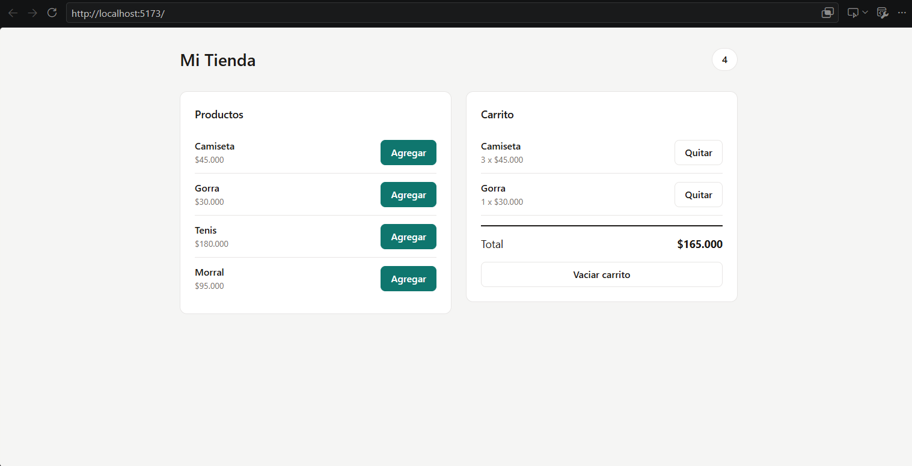

# Tienda Virtual - Carrito de Compras con React y Zustand
Guía práctica desarrollada para el programa Análisis y Desarrollo de Software (ADSO) - SENA.
Instructor: Juan Pablo Chamizzo Vega (2026).

## 📸 Captura de pantalla de la aplicación

---

## 🧠 Respuestas a las Preguntas de Reflexión

**1. ¿Por qué Encabezado se actualiza cuando agregas un producto, si no recibe ninguna prop?**
Porque utiliza el hook del store global de Zustand (`useCarritoStore`). Al suscribirse al estado `items`, Zustand detecta de forma automática cualquier cambio y fuerza la actualización del componente `Encabezado` por cuenta propia, sin requerir transferencia de props desde un componente padre.

**2. ¿Qué tendrías que hacer para lograr lo mismo usando solo useState en App?**
Se tendría que aplicar "elevación de estado" (*lifting state up*), declarando el estado del carrito en el componente raíz (`App`) y pasando tanto el arreglo `items` como la función modificadora a través de múltiples niveles de componentes mediante props ("prop drilling"), volviendo el código más complejo y rígido.

**3. ¿Para qué sirve el selector `(state) => state.items` al usar el hook?**
Sirve para indicarle a Zustand exactamente qué parte específica del estado global queremos consultar. Esto optimiza el rendimiento general, haciendo que el componente se renderice únicamente cuando esa propiedad en particular sufra modificaciones.

**4. ¿Por qué en el store se crean arreglos nuevos con `map` y `filter` en lugar de modificar `items` directamente?**
Porque React y Zustand exigen inmutabilidad en los estados. Modificar el arreglo directamente mediante mutaciones o métodos como `.push()` no cambia su referencia en memoria, por lo que React no detectaría que hubo cambios y omitiría la actualización visual de la interfaz.

**5. ¿Zustand es parte de React? Explica la diferencia entre una librería propia de React y una del ecosistema.**
No, Zustand no pertenece al núcleo de React; es una librería externa creada por la comunidad (del ecosistema). Las herramientas nativas de React vienen integradas de base (como `useState` o `useContext`), mientras que las librerías del ecosistema como Zustand se instalan por separado (`npm install zustand`) para optimizar arquitecturas de estado global de manera más limpia y ligera.